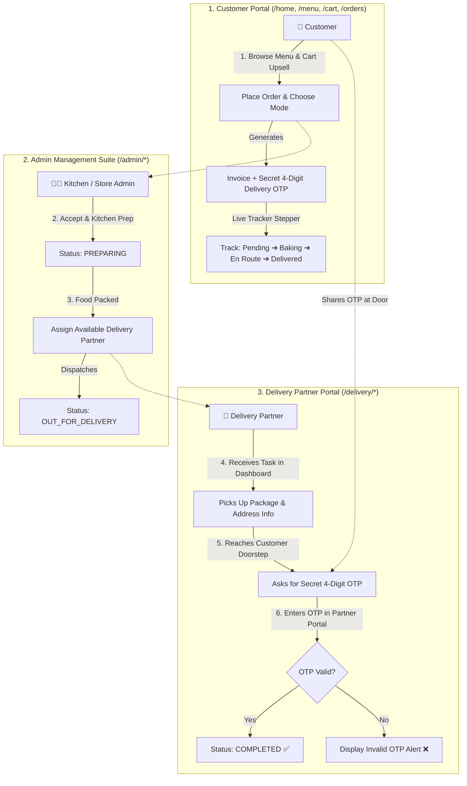

# 📋 FoodZone: 3-Entity Commercial Delivery Ecosystem Plan of Execution
> **Project:** FoodZone Online Food Ordering & Management System  
> **Architectural Target:** 3-Entity Enterprise Model (Customer, Admin, Delivery Partner)  
> **Inspiration & Benchmark:** Domino's Pizza & Swiggy Logistics Workflow  
> **Core Stack:** Java 21, Jakarta EE 10 (Servlets 6.0), JSP & JSTL 3.0, Apache Tomcat 10.1, MySQL 8.0  
> **Execution Status:** Ready for Implementation  

---

## 1. Executive Vision & The 3-Entity Architecture

Currently, FoodZone operates as a 2-tier application (Customer and Admin). Based on our comparative analysis with commercial delivery systems like **Domino's Pizza**, an order cannot be truly completed by only two parties without risking fraud, theft, or inventory disputes.

This execution plan details the transformation of FoodZone into a **3-Entity Triangle Ecosystem**:



---

## 2. Domino's Feature Gaps Being Resolved

| Domino's Workflow | Current FoodZone | Upgraded FoodZone Implementation |
| :--- | :--- | :--- |
| **3-Tier Actors** | Customer & Admin only | **Customer, Admin, AND Delivery Partner (`DELIVERY`)** |
| **Order Verification** | Customer shares 4-digit OTP with rider at door | **Secure 4-Digit Delivery OTP generated upon checkout, verified by rider** |
| **Live Pizza Tracker** | Static status text, manual page refresh | **Animated 4-Stage Visual Stepper with auto-polling (AJAX / auto-refresh)** |
| **Ordering Mode** | Delivery vs. Takeaway / Self-Pickup | **Toggle on checkout: Takeaway waives ₹40 delivery fee to ₹0** |
| **Cart Upselling** | "Complete your meal with Lava Cake & Dips" | **"Pairs Well With" smart add-on strip (Drinks/Desserts) in cart** |
| **Order Cancellation**| Customer can cancel while in `PENDING` | **Self-cancel button on recent orders if kitchen hasn't started** |
| **Rider Dashboard** | Dedicated Driver App | **Dedicated mobile-first `/delivery/dashboard` portal for riders** |

---

## 3. Database Schema Upgrades (`foodzone_db`)

The database will be modified via SQL scripts without losing any existing menu, category, or order records:

```sql
-- 1. Extend user roles to include 'DELIVERY'
ALTER TABLE users 
    MODIFY COLUMN role ENUM('CUSTOMER', 'ADMIN', 'DELIVERY') DEFAULT 'CUSTOMER';

-- 2. Add vehicle details and active status for delivery partners in `users`
ALTER TABLE users 
    ADD COLUMN vehicle_no VARCHAR(30) AFTER phone,
    ADD COLUMN is_active_rider BOOLEAN DEFAULT TRUE AFTER vehicle_no;

-- 3. Extend `orders` table to track order type, OTP, and assigned delivery partner
ALTER TABLE orders 
    ADD COLUMN order_type ENUM('DELIVERY', 'TAKEAWAY') DEFAULT 'DELIVERY' AFTER user_id,
    ADD COLUMN delivery_otp VARCHAR(6) AFTER payment_method,
    ADD COLUMN rider_id INT NULL AFTER delivery_otp,
    ADD CONSTRAINT fk_order_rider FOREIGN KEY (rider_id) REFERENCES users(user_id) 
        ON DELETE SET NULL ON UPDATE CASCADE;

-- 4. Seed a Dedicated Demo Delivery Partner Account
INSERT INTO users (full_name, email, password_hash, phone, vehicle_no, role) 
VALUES ('Vikram Singh (Rider)', 'rider@foodzone.com', 'rider123', '9876500001', 'DL 04 AB 1234', 'DELIVERY')
ON DUPLICATE KEY UPDATE full_name=VALUES(full_name);
```

---

## 4. Phase-by-Phase Technical Implementation Plan

### Phase 1: Database Layer & Data Access Objects (DAOs)
* **Tasks:**
  1. Execute schema migrations on MySQL Server 8.0.
  2. Update `User.java` with `vehicleNo` and `isActiveRider`.
  3. Update `Order.java` with `orderType`, `deliveryOtp`, `riderId`, and `riderName`.
  4. Update `UserDAO.java` with `getAllDeliveryRiders()` method so Admin can select available riders.
  5. Update `OrderDAO.java`:
     * `assignRider(int orderId, int riderId)`: Assigns rider and flips status to `OUT_FOR_DELIVERY`.
     * `verifyAndCompleteOrder(int orderId, String inputOtp)`: Validates 4-digit OTP and flips status to `COMPLETED`.
     * `getOrdersByRider(int riderId)`: Fetches active deliveries for the logged-in rider.
     * `cancelOrder(int orderId, int userId)`: Cancels order if status is still `PENDING`.

---

### Phase 2: Controller & Security Guard Layer (Servlets & Filters)
* **Tasks:**
  1. **New Security Filter:** `DeliveryAuthFilter.java` guarding `/delivery/*` routes so only authenticated riders can access.
  2. **New Controller:** `DeliveryServlet.java` mapped to `/delivery/dashboard` and `/delivery/orders`:
     * `doGet()`: Displays assigned active orders and today's completed deliveries.
     * `doPost()`: Handles OTP verification action `verify-delivery`.
  3. **Update `CheckoutServlet.java`:**
     * Automatically generate cryptographically secure 4-digit OTP: `String.format("%04d", new Random().nextInt(10000))`.
     * Read `orderType` (DELIVERY / TAKEAWAY); if TAKEAWAY, delivery fee is set to `0.00`.
  4. **Update `AdminOrderServlet.java`:**
     * Add dropdown in Admin orders to assign available riders when dispatching.
  5. **Update `AuthServlet.java`:**
     * Redirect riders directly to `/delivery/dashboard` upon logging in.
     * Add a 1-click **"Delivery Partner Demo"** button on `/login`.

---

### Phase 3: Frontend Customer Experience (Tracker, OTP, Takeaway & Upsell)
* **Tasks:**
  1. **Domino's 4-Stage Visual Tracker:**
     * Create animated stepper in `order-confirmation.jsp` and `order-history.jsp`:
       `Order Placed (📝)` ➔ `Kitchen Baking (🍳)` ➔ `Out for Delivery (🛵)` ➔ `Delivered (🏠)`
     * Add 5-second automatic polling so status moves in real-time when the kitchen or rider updates it.
  2. **Secret 4-Digit OTP Badge:**
     * Display a highlighted security card: *"Share OTP [ 8 2 1 9 ] with your delivery partner at doorstep"*.
  3. **Delivery vs. Takeaway Toggle on Checkout:**
     * Dynamic radio cards: If "Takeaway" is selected, dynamically update the bill summary in JavaScript to show `Delivery Fee: ₹0`!
  4. **"Complete Your Meal" (Upselling in Cart):**
     * In `cart.jsp`, display an interactive quick add carousel of top desserts (e.g. *Warm Chocolate Lava Cake ₹149*) and beverages (*Cold Coffee ₹99*).
  5. **Customer Self-Cancel:**
     * Add a "Cancel Order" action in `order-history.jsp` enabled only when status is `PENDING`.

---

### Phase 4: Delivery Partner Portal UI (`/WEB-INF/views/delivery/dashboard.jsp`)
* **Tasks:**
  1. Build a clean, mobile-first delivery interface.
  2. Active delivery card showing:
     * Order Number & Customer Name.
     * Customer Address with Google Maps link + Phone number with `tel:` direct call link.
     * Cash to Collect amount (for Cash on Delivery).
     * Input box for 4-digit OTP + **"Verify & Complete Delivery"** button.
  3. Delivery History tab showing completed orders and earnings for the day.

---

### Phase 5: Build, Deployment & Live Verification
* **Tasks:**
  1. Run `.\build.ps1` to compile Java sources, package WAR, hot-deploy to `C:\apache-tomcat-10.1\webapps\foodzone`.
  2. End-to-end walkthrough verification:
     * Customer orders a pizza + chooses Delivery + adds Cold Coffee upsell.
     * Customer receives OTP `XXXX` on receipt with visual tracker in `PENDING`.
     * Admin moves order to `PREPARING`, then assigns rider *Vikram Singh* (`OUT_FOR_DELIVERY`).
     * Customer tracker automatically updates to `OUT_FOR_DELIVERY` showing rider info.
     * Delivery Boy logs in at `/login`, views order in `/delivery/dashboard`, enters OTP `XXXX`.
     * Order completes, marked `COMPLETED` for all 3 entities!

---

## 5. Demo Credentials for All 3 Entities

| Actor | Email | Password | Assigned Landing Page |
| :--- | :--- | :--- | :--- |
| **👨‍🍳 Store Admin** | `admin@foodzone.com` | `admin123` | `/admin/dashboard` |
| **🛵 Delivery Partner** | `rider@foodzone.com` | `rider123` | `/delivery/dashboard` |
| **👤 Customer** | `customer@gmail.com` | `user123` | `/home` & `/menu` |

---

## 6. Enterprise Depth & Profile Views (Commercial Domino's Standard)

### A. Role-Specific Profile Views
- **Customer Profile (`/profile`):**
  - Personal Information: Name, Email (immutable), Phone, Default Saved Delivery Address.
  - Metrics Dashboard: Total orders placed, lifetime spend, active orders count, completed orders count.
  - Recent Order History Quick-Links.
- **Delivery Partner Profile (`/delivery/profile`):**
  - Verification & Fleet Credentials: Full legal name, contact phone, vehicle type (Motorcycle/Scooter/EV/Bicycle/Car), vehicle number plate, commercial driving license (DL) number, emergency SOS contact.
  - Shift Controls: On-Duty / Off-Duty availability switch.
  - Live Shift Metrics: Today's completed deliveries, cash collected in hand, lifetime trips.
- **Admin Profile (`/admin/profile`):**
  - Central store operator details, direct dispatch hotlinks, system infrastructure metrics.

### B. Enterprise Information Capture & Logistics Depth
- **Structured Address Breakdown:** Flat/House No., Building, Landmark (`landmark`), Address Tag (`HOME`, `WORK`, `OTHER`), and Alternate Phone Number (`alternate_phone`).
- **Domino's Delivery Instruction Presets:** Quick preset chips for *"Do Not Ring Bell"*, *"Leave at Door"*, *"Call Upon Arrival"*, and *"Leave with Security"*.
- **Multi-Stage Progressive Trip Progression:**
  1. `ASSIGNED` ➔ Kitchen packed, assigned to rider.
  2. `PICKED_UP` ➔ Rider confirms kitchen counter pickup, en route.
  3. `ARRIVED` ➔ Rider logs arrival at customer doorstep.
  4. `DELIVERED` ➔ Secure 4-digit OTP handshake with COD cash change calculator & delivery note.
- **30-Minute Delivery Guarantee:** Live ticking countdown timer on tracking page.
- **Post-Delivery Star Rating & Reviews:** 1 to 5 star ratings for Food Quality and Delivery Partner with verified review badge.

---

## 7. Viva Voce & Presentation Defense Cheat Sheet

1. **Why is a 3-Entity architecture better than a 2-Entity one?**
   * *Real-world logistics cannot function without separating the preparation team (kitchen/admin) from the transit team (logistics/rider). It enforces separation of concerns and prevents order dispute.*
2. **What is the security significance of the 4-digit Delivery OTP?**
   * *The OTP acts as a decentralized cryptographic handshake. The delivery executive cannot falsify delivery, and the customer cannot claim they never received their food.*
3. **How does ACID transaction work during Checkout?**
   * *`conn.setAutoCommit(false)` encapsulates the header `orders` table insertion and multiple `order_items` inserts into a single atomic transaction. If any item insert fails, `conn.rollback()` executes, guaranteeing zero orphaned or corrupt rows.*
4. **How are progressive trip stages and COD cash reconciliation managed?**
   * *`orders.trip_stage` tracks granular state transitions (`ASSIGNED` ➔ `PICKED_UP` ➔ `ARRIVED` ➔ `DELIVERED`), while `orders.cash_received` enables real-time shift cash audit against the rider's physical collection.*

